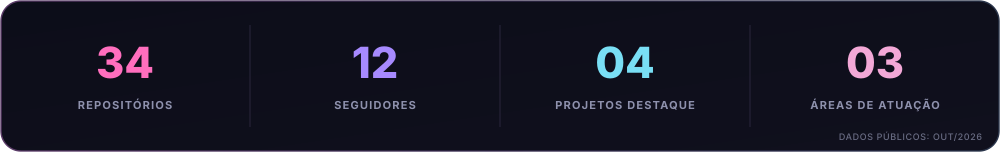
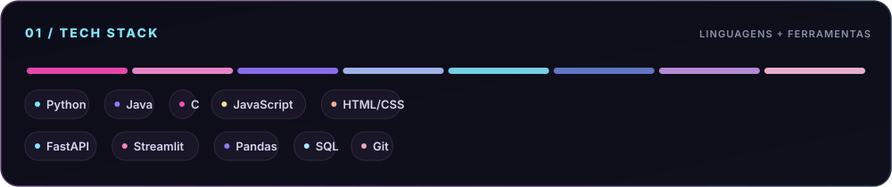
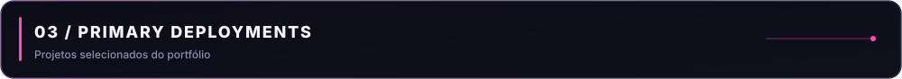
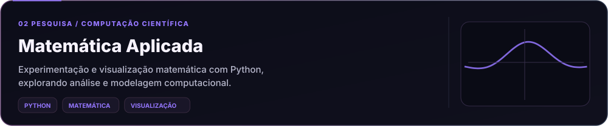
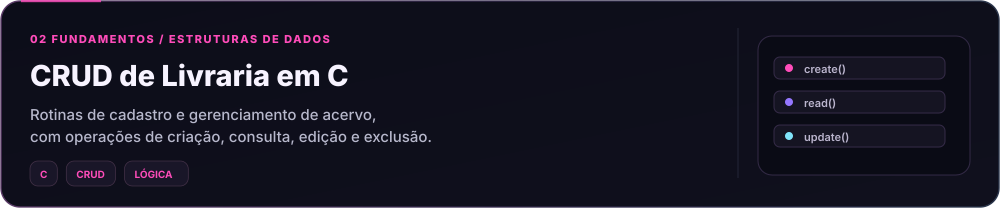

<!--
  NATHÁLIA DE LIMA — Neon Aura Dashboard
  Perfil oficial: https://github.com/nathalialimaa
  As estatísticas são um retrato público de outubro de 2026.
  Os SVGs de apresentação usam animação discreta; o Pac-Man é gerado em GitHub Actions.
-->

  <picture>
    <source media="(max-width: 600px)" srcset="assets/hero-mobile.svg" />
    
  </picture>

  <a href="https://github.com/nathalialimaa">GitHub</a>
  &nbsp; • &nbsp;
  <a href="mailto:nathylima464@gmail.com">E-mail</a>
  &nbsp; • &nbsp;
  <a href="https://instagram.com/nathylimaa14">Instagram</a>
  &nbsp; • &nbsp;
  <a href="https://github.com/nathalialimaa?tab=repositories">Repositórios</a>

  <picture>
    <source media="(max-width: 600px)" srcset="assets/metrics-mobile.svg" />
    
  </picture>

  <picture>
    <source media="(max-width: 600px)" srcset="assets/stack-mobile.svg" />
    
  </picture>

Desenvolvimento de aplicações · APIs · análise de dados · inteligência artificial · pesquisa

  <picture>
    <source media="(max-width: 600px)" srcset="assets/activity-title-mobile.svg" />
    
  </picture>

  <picture>
    <source media="(prefers-color-scheme: dark)" srcset="https://raw.githubusercontent.com/nathalialimaa/nathalialimaa/output/pacman-contribution-graph-dark.svg" />
    <source media="(prefers-color-scheme: light)" srcset="https://raw.githubusercontent.com/nathalialimaa/nathalialimaa/output/pacman-contribution-graph.svg" />
    
  </picture>

  <picture>
    <source media="(max-width: 600px)" srcset="assets/projects-title-mobile.svg" />
    
  </picture>

<a href="https://github.com/nathalialimaa/projeto-matematica-aplicada" title="Abrir Matemática Aplicada no GitHub">
  <picture>
    <source media="(max-width: 600px)" srcset="assets/project-2-mobile.svg" />
    
  </picture>
</a>

<a href="https://github.com/nathalialimaa/Projeto_Crud_Em_C" title="Abrir CRUD de Livraria em C no GitHub">
  <picture>
    <source media="(max-width: 600px)" srcset="assets/project-3-mobile.svg" />
    
  </picture>
</a>

  <a href="https://github.com/nathalialimaa/projeto_imc">Projeto IMC (HTML, CSS e JavaScript)</a>
  &nbsp; • &nbsp;
  <a href="https://github.com/nathalialimaa?tab=repositories">Explorar todos os repositórios</a>

  <picture>
    <source media="(max-width: 600px)" srcset="assets/contact-mobile.svg" />
    
  </picture>

  <a href="mailto:nathylima464@gmail.com">nathylima464@gmail.com</a>
  &nbsp; · &nbsp;
  <a href="https://github.com/nathalialimaa">@nathalialimaa</a>

